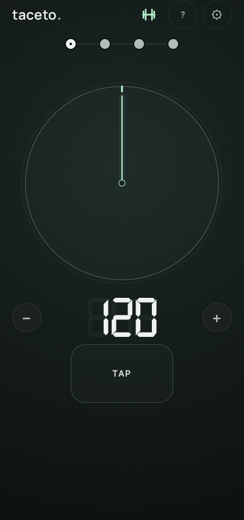
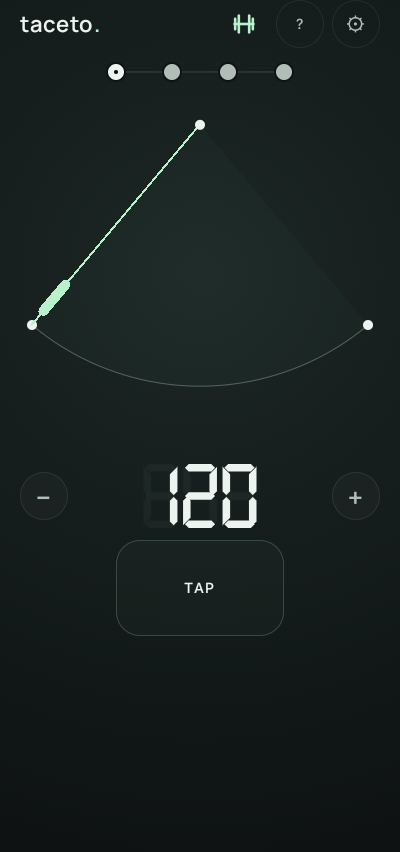
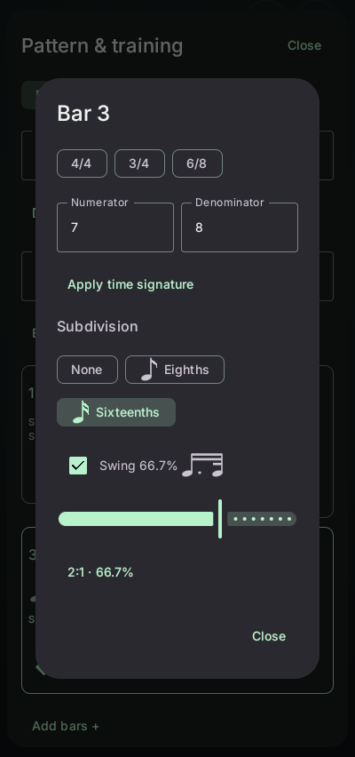
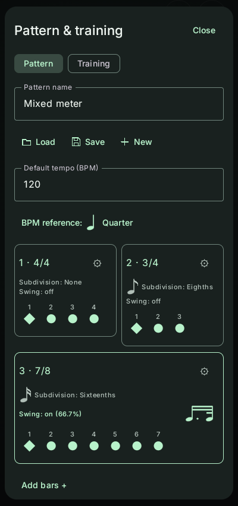
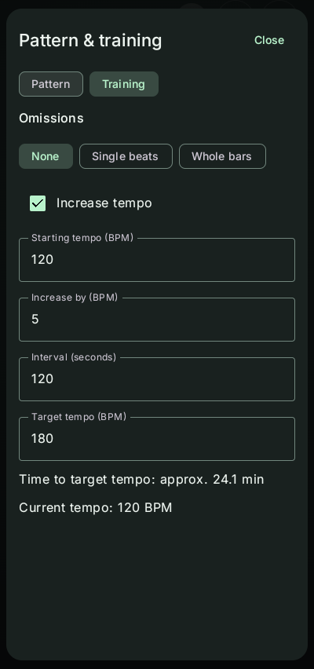

# Taceto Metronome

Native Android metronome built with Kotlin and Jetpack Compose. Requires Android
8.0 (API 26) or later. Audio events are scheduled in a PCM stream; visualization
follows the audio playback position.

## Features

- Circle and pendulum views with a large beat light; tempo input, swipe, +/- and
  tap tempo. Manual tempo changes respond immediately during playback.
- Named, locally saved multi-bar patterns with mixed time signatures. Bars wrap
  into rows with at most two bars per row; each beat cycles on, accented and off.
  Select a bar to duplicate, move or delete it; its gear opens the meter,
  subdivision and swing settings. The BPM reference applies to the whole pattern.
- Eighth- and sixteenth-note subdivisions, adjustable swing and drawn note symbols.
  Pattern default tempo is stored separately from the current practice tempo.
- Optional random beat omissions (protecting the first count) or whole-bar
  omissions with a limit on consecutive silent bars. Visual assistance can be
  disabled. Deliberately muted pattern beats stay muted.
- Optional automatic tempo increases with a starting tempo, step, interval and
  target. A duration preview accounts for bar boundaries and mixed meters.
  Playback continues at the target; stopping resets the run. Manual tempo input
  cancels automatic increases for that run.
- Six bundled sounds, pitch controls for tonal sounds, three accent colours,
  English/German interfaces, and lock-screen transport controls with app artwork.

Tap the beat chain to open the pattern/training editor. Saving and loading show
a confirmation with the pattern name; loading opens a separate selection dialog.
A dumbbell in the main header indicates enabled training options and opens them.

## Screenshots

| Circle | Pendulum | Bar settings |
| :---: | :---: | :---: |
|  |  |  |

| Patterns | Training |
| :---: | :---: |
|  |  |

Screenshots show version 0.2.0 in English, including the current pattern editor,
bar settings and training controls. German is also included.

## Build

Install OpenJDK 17 and the Android SDK (platform 35 and matching build tools).
Set `ANDROID_HOME` to your SDK directory, then run:

```sh
./gradlew :core:test :app:testDebugUnitTest :app:assembleDebug :app:lintDebug
```

Debug APK: `app/build/outputs/apk/debug/app-debug.apk`.
An unsigned release APK can be built with `./gradlew :app:assembleRelease`.
Distribution requires a signing configuration and a securely stored signing key.

The application ID is `io.github.chubacca_dev.taceto`. The Kotlin namespace remains
`de.takt`; the launcher component is `io.github.chubacca_dev.taceto/de.takt.MainActivity`.

### Release signing

Create the signing key once, outside all source repositories:

```sh
python3 tools/release.py create-key \
  --keystore "$HOME/.local/share/taceto/signing/taceto-release.p12"
```

The password is entered interactively and is not saved by the script. Keep the
key file and a separate password backup: future updates need this same identity.
Neither belongs in source control or a public release.

Build an unsigned APK with `./gradlew :app:assembleRelease`, then sign it:

```sh
python3 tools/release.py sign \
  --keystore "$HOME/.local/share/taceto/signing/taceto-release.p12" \
  --apk app/build/outputs/apk/release/app-release-unsigned.apk \
   --output app/build/outputs/apk/release/taceto-0.2.0.apk \
  --apksigner "$ANDROID_HOME/build-tools/34.0.0/apksigner"
```

Install Android build-tools 34.0.0 for the signing command; building uses pinned
build-tools 35.0.0. The separate signer version is chosen for compatibility with
F-Droid signature-copying tools. The script verifies the signed APK and prints
its SHA-256 and public certificate details. APKs use v2/v3 signatures (minSdk 26).
Existing keys and output APKs are never overwritten.

The official release certificate SHA-256 fingerprint is:

```text
c1fbe74397d10bcbe3515e60f61c99dc7c37bb15d6b3852d8cbeac3db1f8f44d
```

Verify downloaded APKs with `apksigner verify --verbose --print-certs <file.apk>`
and compare the signer certificate fingerprint, not just the application name.

Release APKs omit automatically generated VCS metadata, so builds from the
public source snapshot do not depend on an unrelated development repository.
F-Droid distribution with the same developer signature requires verification
against the F-Droid build environment; a local repeat-build check alone is not
sufficient.

## Lock-screen controls

Start the metronome once in the app to make Android's media controls available.
You can then stop and restart it from the lock screen or media notification.
Stopping resets to the beginning; the next start does not resume mid-bar.
Audio focus and the playback wake lock are released while stopped.

Availability and layout depend on Android and your lock-screen settings. Controls
are not guaranteed to remain available after Android terminates the app or the
device restarts.

## Audio timing and calibration

The sound bank is prepared in the background. Playback uses a fixed 40 ms silent
preroll before musical frame zero; device and output-route latency add to this.
There is no fast-start switch.

Bluetooth headphones can add delay beyond the position reported by Android.
Settings provides a manual **Picture delay** adjustment from 0 to 1000 ms. If the
beat light leads the heard click, increase this value. It changes the displayed
position only, not the audio stream or tempo. The preference is global: reset it
when changing output devices. Variable Bluetooth latency cannot be eliminated
with a fixed display offset.

TAP estimates BPM from up to six taps (five intervals), restarting after a gap
longer than 2.5 seconds. It sets tempo, not the beat phase of an external song.
Swing note-pair graphics are long-short motifs; the numeric swing percentage
determines the actual timing.

## Languages

The app includes English (default/fallback) and German. Language can follow the
system or be selected in Settings. Android 13+ also exposes the app languages in
system settings. All translations ship offline with the APK.

Resource files live in `app/src/main/res/values/strings.xml` and
`app/src/main/res/values-de/strings.xml`. Validate their completeness and format
placeholders with `python3 tools/check_translations.py`.

### Sound assets

The bundled PCM bank is generated by the included Python scripts, using only the
Python 3 standard library and no third-party samples. To regenerate it:

```sh
python3 tools/generate_sounds.py
python3 tools/package_sounds.py
```

The first command creates the intermediate WAV files in `sounds/`; the second
checks the zero-pitch variants and packages the PCM bank. Generation is not
required for a normal Android build.

## License

The original Taceto application code, build scripts, sound generators and generated
sound assets are licensed under **GNU GPL version 3 only** (`GPL-3.0-only`). See
`LICENSE`. This notice does not relicense third-party components.

Manrope and Inter are distributed under the SIL Open Font License 1.1; their
copyright notices and license texts are included in `app/src/main/assets/fonts/`.
The Gradle wrapper and external dependencies retain their respective licenses.
